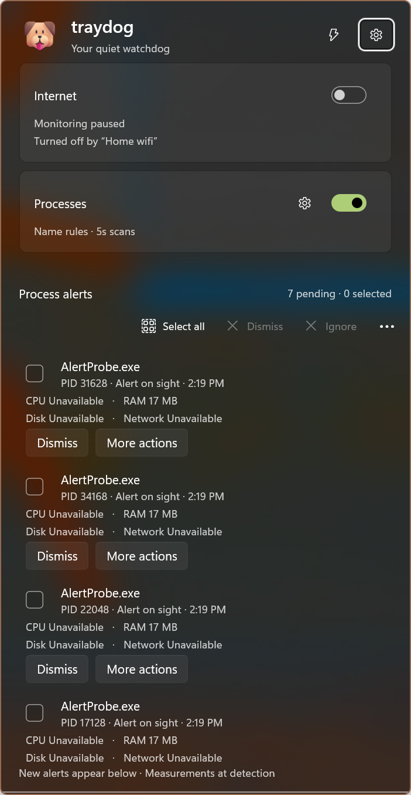

# traydog

 

A quiet watchdog for your internet connection and resource-hungry processes, living in the Windows notification area.

traydog is a tray-only Windows app built with [Microsoft.UI.Reactor](https://github.com/microsoft/microsoft-ui-reactor), a React-style C# UI framework over WinUI 3. It has no main window: the tray icon opens a small popout next to it.

## What it does

- **Connection status:** while monitoring is on, traydog pings `8.8.8.8` and fetches Microsoft's connectivity test page (`http://www.msftconnecttest.com/connecttest.txt`). Only a successful HTTP round-trip counts as online. A ping reply or an active network adapter without HTTP means "Internet unavailable" (captive portal, DNS trouble). No adapter at all means "No network connection".
- **Tray icon:** the dog when monitoring is off (and during the first check), then a check mark (online), warning sign (network but no internet), or globe (offline). The tooltip says the same in words. The icons are full-color, so they read on light and dark taskbars.
- **One monitoring popout:** independent Internet and Processes switches, connection health and ping details, process-check coverage, and a shared process-alert list. Situations and Settings are in the header; the gear beside Processes opens thresholds, rules, and collector settings. A bar along the bottom counts down to the next connection check.
  - Opens taller when there are more pending alerts, up to the monitor's available height. While open, its position and size stay fixed: new alerts append at the bottom of the scrollable list without moving existing buttons or taking keyboard focus.
  - Each alert shows the executable, PID, detection time, flagged resources, and measurement snapshot. **Dismiss** is inline; **More actions** contains Search online and both Ignore choices.
  - Select individual alerts or **Select all**, then **Dismiss** or **Ignore** the selection. The toolbar's overflow menu includes **Ignore every time** and Clear selection. Select all selects only the alerts present at that moment, not later arrivals.
- **Check cadence:** every 15 seconds while the popout is open, and every minute (configurable) while it's closed. A network change (Wi-Fi drop, cable unplugged, VPN connect) triggers a check right away.
- **Remembers your choice:** if you leave monitoring on, it resumes the next time traydog starts.
- **Process monitoring:** opt-in background checks for high per-process CPU, RAM, Disk, and Network usage. Open its settings from **Processes** in the tray menu or the gear beside Processes in the popout.
  - Scans every **30 seconds**, with **1-second** rechecks of suspect processes only. Each resource must remain high for **20 seconds** before an alert; a brief spike is not enough. All timings and thresholds are editable.
  - Defaults: **80% CPU** across the whole machine, **1 GB RAM** (working set), **50 MB/s Disk**, and **10 MB/s Network**. MB means 1024 x 1024 bytes. Disk is physical read/write throughput, not disk active-time percentage or cached file traffic. Network includes TCP/UDP, IPv4/IPv6, sending and receiving.
  - CPU and RAM need no administrator permission. **Enable (admin)** starts an optional, separate read-only Windows ETW collector for accurate, separate Disk/Network measurements and process-launch events. Ordinary process I/O counters mix disk and network, so traydog deliberately does not use them as a substitute. Permission is requested by a user gesture, never automatically at startup or by a situation, and must be granted again after restarting monitoring.
  - Alerts open the unified monitoring popout next to the notification icon without taking keyboard focus. If it is already open, alerts update the list without navigating away from Settings. Search online opens an escaped executable-name query in your default browser. **Dismiss** allows a reminder after 15 minutes if usage remains high; **Ignore this time** mutes that process instance until it exits; **Ignore every time** saves an executable-name rule.
  - **Alert on sight** rules alert for each new instance of a named executable even when usage is low, including a matching process already running when the rule or monitor is enabled. With the collector connected, process launches are event-driven. Without it, rules use background scans and may miss short-lived processes.
  - Rules match exact executable names case-insensitively, across all folders. Ignore and alert-on-sight rules are mutually exclusive; adding one replaces the other for that name. Rules can be removed in **Processes > Rules**. No process is ever terminated or modified.
  - Protected processes that Windows does not allow traydog to read are reported as unavailable, not zero. Dropped tracing events are reported and interrupt Disk/Network confirmation. At most 100 pending alerts are retained. When full, existing rows stay in place and an explicit notice counts additional alerts that were not listed.
- **Situations:** let traydog switch monitoring on or off for you. A situation is a set of conditions, all or any of which must hold:
  - **Network:** connected (or not) to a named Wi-Fi or wired network.
  - **Place:** within (or farther than) 100 m to 5 km of a place you set with "Use my current location".
  - **Battery and power:** battery below or at least a percentage, plugged in, or on battery.
  - **Device:** a named device is connected (or not): headphones, a dock, a monitor, a mouse.
  - **Time of day:** between (or outside) two times, on the days you pick. Overnight windows work.

  While a situation holds, it turns each monitor on or off, or leaves it alone. When it ends, the monitor goes back to what you chose. If you switch monitoring yourself while a situation is in charge, your choice lasts until that situation changes. When two situations want the same monitor, the one higher in the list wins. The popout says which situation turned monitoring on or off, and the tray tooltip lists the active ones.

  Open situations from the lightning button in the popout header or from the tray menu. Its tooltip lists active situations. The editor shows, for each condition, whether it's true right now. Internet and process monitoring can be switched independently by situations.
- **Settings:** the gear button, or Settings in the tray menu, opens a settings page inside the popout:
  - **Start with Windows:** opt-in. If you turned traydog off in Windows Settings > Apps > Startup, or a policy controls it, the switch is locked and says why.
  - **Check in the background:** every 30 seconds, every minute, or every 5 minutes.
- **Tray menu:** right-click for Open traydog, one on/off toggle per monitor, Situations, Processes, Settings, and Exit. Pending process alerts give the tray icon a warning state.
- **Feels like part of Windows:** the popout uses the same acrylic as the shell's own flyouts, follows the taskbar's light or dark theme (and its accent tint), slides in, and closes when you click elsewhere. Escape goes back from Settings, then closes the popout.
- **Single instance:** launching traydog again opens the running copy's popout instead of adding a second icon.

## Install

traydog is distributed as an MSIX package for Windows 10 1809 (build 17763) or later, on x64 or ARM64.

- **Microsoft Store:** Tray Dog. <!-- TODO: link the Store listing once it's live. -->
- **GitHub:** signed `.msix` packages for each version go on [releases](https://github.com/TheJoeFin/traydog/releases). If Windows doesn't trust the signing certificate on your machine, install the certificate first or use the Store version.

The first launch opens the popout so you can see where traydog lives. After that it starts quietly in the tray. Look in the taskbar overflow (^) if the icon is hidden, and drag it onto the taskbar to keep it visible.

## Privacy and footprint

- **Network:** connection monitoring contacts only `8.8.8.8` (ICMP ping) and `www.msftconnecttest.com` (one small HTTP GET). Resource monitoring sends nothing over the network. Search online explicitly opens a Bing search for the executable name in your browser. There's no telemetry.
- **Resource measurements:** collected locally. The optional elevated collector totals disk and network byte counts, without saving trace files, packet contents, socket addresses, stacks, command lines, or browsing history. Only counters and matching process-launch names cross a current-user-only named pipe; each endpoint verifies the other process. It stops and releases its tracing session when monitoring is disabled, its pipe closes, or traydog exits.
- **Situations:** conditions are checked on the PC, from Windows' own network, power, device, and location information, and only for the kinds of condition your enabled situations use. Location is used only when a situation has a place condition: Windows asks for permission the first time, and traydog then takes one quick location fix every 10 minutes and when your network changes. traydog never sends your location anywhere.
- **Storage:** a few preferences in the app's local settings, your situations in `situations.json` (including any place coordinates), and resource thresholds/rules in `resources.json` in the app's local folder. Process samples, alerts, and per-instance mutes are in memory only. There are no accounts, keys, or tokens.
- **Idle cost:** connection checks run one at a time and slow down while hidden. Process monitoring holds only counter baselines and bounded alert state, disposes every process handle after sampling, and speeds up only for suspects. The optional ETW collector continuously receives just process/thread, disk, and network events with a small buffer; it adds CPU/memory cost while enabled, especially on busy machines. Situations prefer Windows notifications. Windows close for real when unused, allowing memory to return to Windows. The original 10–25 MB idle target applies with process tracing off, not to the combined footprint of an active elevated collector.
- **Crashes:** unhandled exceptions are appended to `%TEMP%\traydog-crash.log`.

## Build from source

Prerequisites: the [.NET 10 SDK](https://dotnet.microsoft.com/download), the winapp CLI (`winget install Microsoft.WinAppCli`), and Developer Mode (Settings > System > For developers) so the app can be registered with package identity.

```powershell
winapp run              # build, register with package identity, and launch
winapp run --clean      # same, but from a first-run state
dotnet test traydog.slnx
```

Package identity is required for settings and the startup task, so launch through `winapp run` (or Visual Studio's packaged profile) rather than the bare `.exe`.

To work on the popout UI alone, the `traydog Devtools` launch profile (`--devtools`) mounts it in an ordinary window for the Reactor devtools and the Visual Studio embedded preview. That mode has no tray icon.

### Packages

- **Microsoft Store upload:** use the `Store` build configuration. See [CLAUDE.md](CLAUDE.md#store-msix-build) for the MSBuild command that produces the x64 + ARM64 `.msixupload`.
- **GitHub release:** `build-msix-for-gh.ps1` publishes and signs x64 and ARM64 packages and drafts a GitHub release tagged from `Identity/@Version` in `Package.appxmanifest`. It needs `Properties\PublishProfiles\win-x64.pubxml` and `win-arm64.pubxml` (gitignored) and the maintainer's `sign-msix` PowerShell function.

## Project layout

| Path | What it holds |
|---|---|
| `Program.cs` | Entry point: crash logging, single instance, and the headless `ReactorApp.Run` startup |
| `UI/TrayApp.cs` | Tray icon, tray menu, the popout's window slot, and Exit |
| `UI/PopoutWindow.cs` | The popout window: placement, light dismiss, slide/fade, idle close |
| `UI/TrayPopout.cs` | Root Reactor component: page switching, taskbar theme, Escape and back keys |
| `UI/StatusPage.cs`, `UI/SettingsPage.cs` | The popout's two pages |
| `UI/PopoutStore.cs` | Which page is showing and whether the popout is on screen |
| `UI/ShellBackdrop.cs` | Acrylic that matches the shell's own flyouts |
| `UI/SituationsWindow.cs`, `UI/SituationsEditor.cs`, `UI/SituationEditor.cs` | The situations editor window |
| `Monitoring/Monitors.cs`, `Monitoring/InternetMonitor.cs` | The monitor interface and switchboard (usual choice, situation demand, override) |
| `Monitoring/Watchdog.cs` | App-lifetime monitoring state shared by the tray icon and the popout |
| `Resources/` | Resource options/rules, adaptive alert policy, process sampler, persistence, optional elevated collector and pipe client |
| `UI/ResourcesWindow.cs`, `UI/ResourcesPage.cs` | Resource settings, thresholds, and rules |
| `UI/ResourceAlertsContent.cs`, `UI/MonitoringLayout.cs` | Shared multi-alert list, selection/actions, and bounded popout sizing |
| `Situations/` | The situation model, policy, wording, and JSON (unit tested), the engine, its store, and the sensors |
| `Monitoring/ConnectivityMonitor.cs` | The ping + HTTP probe loop |
| `Monitoring/StatusText.cs`, `Monitoring/CheckInterval.cs` | Wording, icons, countdown math, and interval choices (unit tested) |
| `Platform/` | Tray-anchored placement, single instance, crash log |
| `Services/` | Settings, startup task, system theme, and idle memory release |
| `traydog.Tests/` | MSTest unit tests over the WinRT-free logic |

## License

MIT, see [LICENSE.txt](LICENSE.txt).
