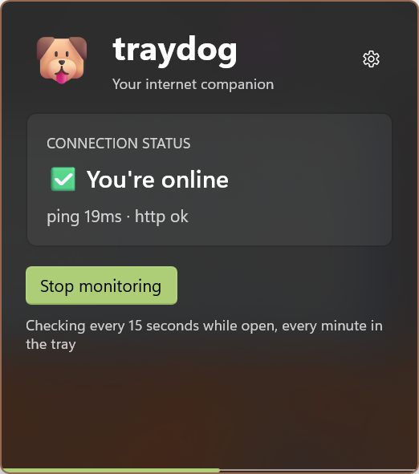
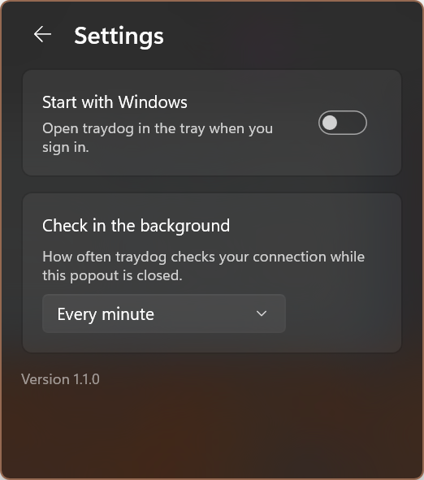

# traydog

 

A watchdog for your internet connection that lives in the Windows notification area. Glance at the tray icon to see whether you're online; click it for the details.

traydog is a tray-only Windows app built with [Microsoft.UI.Reactor](https://github.com/microsoft/microsoft-ui-reactor), a React-style C# UI framework over WinUI 3. It has no main window: the tray icon opens a small popout next to it.

## What it does

- **Connection status:** while monitoring is on, traydog pings `8.8.8.8` and fetches Microsoft's connectivity test page (`http://www.msftconnecttest.com/connecttest.txt`). Only a successful HTTP round-trip counts as online. A ping reply or an active network adapter without HTTP means "Internet unavailable" (captive portal, DNS trouble). No adapter at all means "No network connection".
- **Tray icon:** the dog when monitoring is off (and during the first check), then a check mark (online), warning sign (network but no internet), or globe (offline). The tooltip says the same in words. The icons are full-color, so they read on light and dark taskbars.
- **Popout:** the current status with the latest ping time, a Start/Stop monitoring button, and a bar along the bottom counting down to the next check.
- **Check cadence:** every 15 seconds while the popout is open, and every minute (configurable) while it's closed. A network change (Wi-Fi drop, cable unplugged, VPN connect) triggers a check right away.
- **Remembers your choice:** if you leave monitoring on, it resumes the next time traydog starts.
- **Situations:** let traydog switch monitoring on or off for you. A situation is a set of conditions, all or any of which must hold:
  - **Network:** connected (or not) to a named Wi-Fi or wired network.
  - **Place:** within (or farther than) 100 m to 5 km of a place you set with "Use my current location".
  - **Battery and power:** battery below or at least a percentage, plugged in, or on battery.
  - **Device:** a named device is connected (or not): headphones, a dock, a monitor, a mouse.
  - **Time of day:** between (or outside) two times, on the days you pick. Overnight windows work.

  While a situation holds, it turns each monitor on or off, or leaves it alone. When it ends, the monitor goes back to what you chose. If you switch monitoring yourself while a situation is in charge, your choice lasts until that situation changes. When two situations want the same monitor, the one higher in the list wins. The popout says which situation turned monitoring on or off, and the tray tooltip lists the active ones.

  Open situations from the link at the bottom of the popout or from the tray menu. The editor shows, for each condition, whether it's true right now. Internet monitoring is the only monitor today; situations are built so that new monitors plug in.
- **Settings:** the gear button, or Settings in the tray menu, opens a settings page inside the popout:
  - **Start with Windows:** opt-in. If you turned traydog off in Windows Settings > Apps > Startup, or a policy controls it, the switch is locked and says why.
  - **Check in the background:** every 30 seconds, every minute, or every 5 minutes.
- **Tray menu:** right-click for Open traydog, Internet monitoring (on/off), Situations, Settings, and Exit.
- **Feels like part of Windows:** the popout uses the same acrylic as the shell's own flyouts, follows the taskbar's light or dark theme (and its accent tint), slides in, and closes when you click elsewhere. Escape goes back from Settings, then closes the popout.
- **Single instance:** launching traydog again opens the running copy's popout instead of adding a second icon.

## Install

traydog is distributed as an MSIX package for Windows 10 1809 (build 17763) or later, on x64 or ARM64.

- **Microsoft Store:** Tray Dog. <!-- TODO: link the Store listing once it's live. -->
- **GitHub:** signed `.msix` packages for each version go on [releases](https://github.com/TheJoeFin/traydog/releases). If Windows doesn't trust the signing certificate on your machine, install the certificate first or use the Store version.

The first launch opens the popout so you can see where traydog lives. After that it starts quietly in the tray. Look in the taskbar overflow (^) if the icon is hidden, and drag it onto the taskbar to keep it visible.

## Privacy and footprint

- **Network:** traydog contacts only `8.8.8.8` (ICMP ping) and `www.msftconnecttest.com` (one small HTTP GET), and only while monitoring is on. Nothing is sent anywhere else, and there's no telemetry.
- **Situations:** conditions are checked on the PC, from Windows' own network, power, device, and location information, and only for the kinds of condition your enabled situations use. Location is used only when a situation has a place condition: Windows asks for permission the first time, and traydog then takes one quick location fix every 10 minutes and when your network changes. traydog never sends your location anywhere.
- **Storage:** a few preferences in the app's local settings (whether you've launched before, whether monitoring is on, the background check interval) and your situations in `situations.json` in the app's local folder, including any place coordinates you set. There are no accounts, keys, or tokens.
- **Idle cost:** monitoring runs one probe at a time and slows down while the popout is closed. Situations listen for Windows notifications rather than polling. The popout and situations windows close for real when you're done, and traydog gives the memory back to Windows. Its idle working set is about 10–25 MB.
- **Crashes:** unhandled exceptions are appended to `%TEMP%\traydog-crash.log`.

## Build from source

Prerequisites: the [.NET 10 SDK](https://dotnet.microsoft.com/download), the winapp CLI (`winget install Microsoft.WinAppCli`), and Developer Mode (Settings > System > For developers) so the app can be registered with package identity.

```powershell
winapp run              # build, register with package identity, and launch
winapp run --clean      # same, but from a first-run state
dotnet test traydog.slnx
```

Package identity is required for settings and the startup task, so launch through `winapp run` (or Visual Studio's packaged profile) rather than the bare `.exe`.

To work on the popout UI alone, the `traydog Devtools` launch profile (`--devtools`) mounts it in an ordinary window for the Reactor devtools and the Visual Studio embedded preview. That mode has no tray icon.

### Packages

- **Microsoft Store upload:** use the `Store` build configuration. See [CLAUDE.md](CLAUDE.md#store-msix-build) for the MSBuild command that produces the x64 + ARM64 `.msixupload`.
- **GitHub release:** `build-msix-for-gh.ps1` publishes and signs x64 and ARM64 packages and drafts a GitHub release tagged from `Identity/@Version` in `Package.appxmanifest`. It needs `Properties\PublishProfiles\win-x64.pubxml` and `win-arm64.pubxml` (gitignored) and the maintainer's `sign-msix` PowerShell function.

## Project layout

| Path | What it holds |
|---|---|
| `Program.cs` | Entry point: crash logging, single instance, and the headless `ReactorApp.Run` startup |
| `UI/TrayApp.cs` | Tray icon, tray menu, the popout's window slot, and Exit |
| `UI/PopoutWindow.cs` | The popout window: placement, light dismiss, slide/fade, idle close |
| `UI/TrayPopout.cs` | Root Reactor component: page switching, taskbar theme, Escape and back keys |
| `UI/StatusPage.cs`, `UI/SettingsPage.cs` | The popout's two pages |
| `UI/PopoutStore.cs` | Which page is showing and whether the popout is on screen |
| `UI/ShellBackdrop.cs` | Acrylic that matches the shell's own flyouts |
| `UI/SituationsWindow.cs`, `UI/SituationsEditor.cs`, `UI/SituationEditor.cs` | The situations editor window |
| `Monitoring/Monitors.cs`, `Monitoring/InternetMonitor.cs` | The monitor interface and switchboard (usual choice, situation demand, override) |
| `Monitoring/Watchdog.cs` | App-lifetime monitoring state shared by the tray icon and the popout |
| `Situations/` | The situation model, policy, wording, and JSON (unit tested), the engine, its store, and the sensors |
| `Monitoring/ConnectivityMonitor.cs` | The ping + HTTP probe loop |
| `Monitoring/StatusText.cs`, `Monitoring/CheckInterval.cs` | Wording, icons, countdown math, and interval choices (unit tested) |
| `Platform/` | Tray-anchored placement, single instance, crash log |
| `Services/` | Settings, startup task, system theme, and idle memory release |
| `traydog.Tests/` | MSTest unit tests over the WinRT-free logic |

## License

MIT, see [LICENSE.txt](LICENSE.txt).
